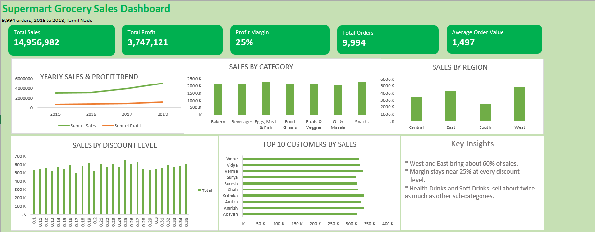

# Supermart Grocery Sales Dashboard (Excel)

I studied 9,994 grocery orders from 2015 to 2018 and built an Excel dashboard.

## Questions I answered
- How did sales and profit change each year?
- Which categories sell and earn the most?
- Which regions do best?
- Do bigger discounts bring more sales?
- Who are the top 10 customers?

## What I found
- West and East bring about 60% of sales.
- Profit margin stays near 25% at every discount level.
- Health Drinks and Soft Drinks sell about twice as much as other sub-categories.
- North has 1 order only, so it is left out of the region chart.

## Tools
Excel: pivot tables, pivot charts, KPIs.

## Data
Supermart Grocery Sales (Kaggle, by Mohamed Harris). It is a made-up dataset.
